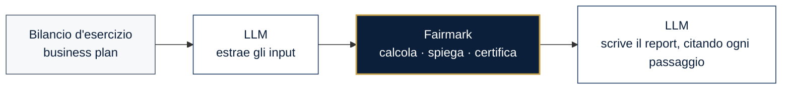
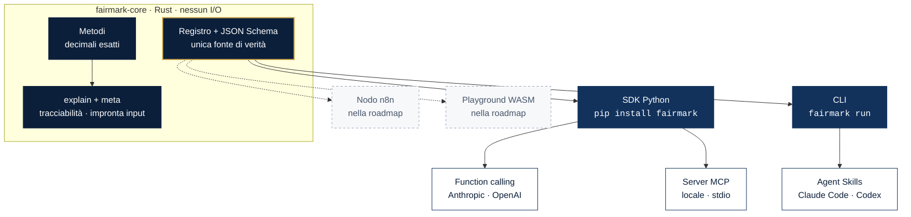

<!-- i18n source: README.md source_hash: ab99cf9092b6 -->
<div align="center">

<a href="https://salvo8519.github.io/fairmark/it/">
  <picture>
    <source media="(prefers-color-scheme: dark)" srcset="docs/_shared/assets/brand/banner-dark.svg">
    
  </picture>
</a>

[English](README.md) · **Italiano**

<h3>Il motore di valutazione deterministico per analisti e agenti AI.</h3>

Il tuo agente legge i documenti e scrive il report. Fairmark fa i conti:<br/>
in modo esatto, riproducibile, con ogni passaggio documentato.

[](https://github.com/salvo8519/fairmark/actions/workflows/ci.yml)
[](https://salvo8519.github.io/fairmark/it/)
[](https://pypi.org/project/fairmark/)
[](https://pypi.org/project/fairmark/)
[](https://crates.io/crates/fairmark-core)
[](LICENSE)

[](https://salvo8519.github.io/fairmark/it/guides/mcp/)
[](https://salvo8519.github.io/fairmark/it/guides/function-calling/)
[](crates/fairmark-core)
[](https://docs.astral.sh/uv/)
[](specs/README.md)

**[Documentazione](https://salvo8519.github.io/fairmark/it/)** ·
**[Guida rapida](https://salvo8519.github.io/fairmark/it/getting-started/quickstart/)** ·
**[Metodi](https://salvo8519.github.io/fairmark/it/methods/)** ·
**[Roadmap](https://salvo8519.github.io/fairmark/project/roadmap/)** ·
**[Contribuire](CONTRIBUTING.md)**

</div>

---

## Perché Fairmark

I modelli linguistici sono eccellenti nel leggere un bilancio e nel redigere un memorandum di
investimento. Non sono calcolatrici affidabili: un fattore di sconto arrotondato male, un
valore terminale attualizzato un anno di troppo, un tasso di crescita letto come 20 invece di
0,02. In una valutazione questi errori cambiano il risultato, e nessuno se ne accorge.

Fairmark divide il lavoro in due:



| | |
| --- | --- |
| **Deterministico** | Aritmetica decimale esatta, algoritmi fissi. Stesso input, stesso output, fino all'ultima cifra, su ogni piattaforma. |
| **Verificabile** | Ogni risultato contiene `explain`: formula, convenzioni e ogni passaggio intermedio, pronti per la relazione di valutazione. |
| **Riproducibile** | Ogni risultato contiene un'impronta dell'input; `fairmark verify` lo riesegue identico, bit per bit. |
| **Nativo per gli agenti** | Un solo motore per Python, function calling, MCP, CLI e Agent Skills per Claude Code e Codex. |
| **Pensato per le non quotate** | Gli input arrivano dal bilancio e dal business plan, non da un ticker. La prassi europea è supportata in modo nativo. |
| **Privato per progettazione** | Il motore non accede mai alla rete. I tuoi numeri restano sul tuo computer. |

## Installazione

```bash
uv add fairmark              # oppure: pip install fairmark
uv add "fairmark[mcp]"       # più il server MCP
```

Wheel precompilate per Linux, macOS e Windows (x86_64 e arm64): non serve un compilatore.

## Guida rapida

```python
import fairmark as fm

r = fm.dcf.fcff(
    free_cash_flows=[100, 110, 120],
    discount_rate="0.10",          # WACC, come frazione decimale
    terminal_growth="0.02",
    net_debt=200,
)

r.enterprise_value       # Decimal('1421.4876033057851239669421487')
r.equity_value           # Decimal('1221.4876033057851239669421487')
r.terminal_value_weight  # Decimal('0.8086680761099365750528541226')
print(r.explain_markdown())
```

```text
| Step                          | Calculation                        | Value       |
| ----------------------------- | ---------------------------------- | ----------: |
| Discount factor, year 1       | 1 / (1 + 0.10)^1                   | 0.909090... |
| Present value of FCFF, year 1 | 100 × 0.909090...                  | 90.909090...|
| Terminal value at year n      | 120 × (1 + 0.02) / (0.10 − 0.02)   | 1530        |
| Enterprise value              | 271.9759... + 1149.5116...         | 1421.4876...|
```

> **Suggerimento.** Passa importi e tassi come stringhe o `Decimal` per mantenerli esatti. I
> float sono accettati e convertiti tramite la rappresentazione più breve (`0.1` → `"0.1"`).
> L'output del motore (passaggi, convenzioni, errori) è in inglese.

## Usarlo da un agente AI

<table>
<tr><th>Function calling</th><th>Server MCP</th></tr>
<tr><td>

```python
resp = client.messages.create(
    model="claude-opus-5-5",
    tools=fm.tools.anthropic(),   # oppure fm.tools.openai()
    messages=messages,
)
for block in resp.content:
    if block.type == "tool_use":
        out = fm.tools.dispatch(block.name, block.input)
```

</td><td>

```json
{
  "mcpServers": {
    "fairmark": {
      "command": "uvx",
      "args": ["--from", "fairmark[mcp]", "fairmark-mcp"]
    }
  }
}
```

</td></tr>
</table>

**Qualsiasi provider**: Anthropic, OpenAI, Google Gemini, OpenRouter, LiteLLM e modelli
open-weight su Ollama, vLLM o LM Studio. `fm.tools.for_provider("ollama")` restituisce il formato
giusto dei tool, `fm.tools.dispatch` esegue la chiamata. Sono inclusi i tool per LangChain e MCP
via HTTP (per n8n). Vedi [Provider LLM](https://salvo8519.github.io/fairmark/it/guides/providers/).

**Claude Code, Codex e altri agenti di sviluppo**: copia [`skills/fairmark`](skills/fairmark)
nella cartella delle skill del tuo agente, oppure lascia che usi la CLI:

```bash
fairmark methods                                  # che cosa posso calcolare?
fairmark schema dcf.fcff                          # quali input, con quali unità?
fairmark run dcf.fcff --input company.json        # JSON in ingresso, JSON in uscita
fairmark verify result.json --input company.json  # riproduce un risultato bit per bit
```

> **Nota.** Le definizioni dei tool sono generate dagli JSON Schema del motore, quindi non si
> discostano mai dall'implementazione. Gli input non validi restituiscono
> `{"error": {"code": "FM-E004", …}}`, così il modello può correggere la propria chiamata.

## Metodi

<!-- generated:methods:start (scripts/gen_reference.py) -->

| Metodo | Stato | Descrizione |
| --- | --- | --- |
| `dates.year_fraction` | Disponibile | Year fraction (day count) |
| `rates.convert` | Disponibile | Rate conversion between compounding conventions |
| `rates.real_nominal` | Disponibile | Real and nominal rates (Fisher) |
| `tvm.npv` | Disponibile | Net present value |
| `tvm.present_value` | Disponibile | Present value with a constant or time-varying rate |
| `tvm.xnpv` | Disponibile | Net present value of dated cash flows (XNPV) |
| `tvm.irr` | Disponibile | Internal rate of return |
| `tvm.xirr` | Disponibile | Internal rate of return of dated cash flows (XIRR) |
| `tvm.mirr` | Disponibile | Modified internal rate of return (MIRR) |
| `tvm.annuity` | Disponibile | Annuity (level or growing, ordinary or due) |
| `tvm.perpetuity` | Disponibile | Perpetuity (level or growing) |
| `coc.cost_of_equity` | Disponibile | Cost of equity (CAPM with explicit premia) |
| `coc.beta_relever` | Disponibile | Beta unlevering and relevering |
| `coc.beta_peers` | Disponibile | Beta from comparable companies |
| `coc.cost_of_debt` | Disponibile | Cost of debt |
| `coc.wacc` | Disponibile | Weighted average cost of capital (WACC) |
| `dcf.fcff` | Anteprima | DCF — unlevered free cash flow |
| `analysis.goal_seek` | Disponibile | Goal seek |

Le prossime funzionalità, con le loro issue e specifiche, sono nella [roadmap](https://salvo8519.github.io/fairmark/project/roadmap/), generata dal piano.

<!-- generated:methods:end -->

## Architettura



> **Un solo motore, adattatori sottili.** Ogni canale è generato dallo stesso registro e dagli
> stessi schemi: un metodo aggiunto al core è subito disponibile in Python, nella CLI, via MCP e
> per ogni LLM. Dettagli in [docs/it/concepts/architecture.md](docs/it/concepts/architecture.md).

## Il contratto di determinismo

1. Solo aritmetica decimale: nessun `f64` in un percorso di calcolo.
2. Algoritmi fissi; tolleranze e numero di iterazioni sono riportati nel risultato.
3. Nessun valore predefinito implicito: input sconosciuti o mancanti sono errori tipizzati con
   codici stabili.
4. Ogni risultato contiene `meta.input_hash`: stesso hash e stesse versioni, stesso risultato.
5. Ogni modifica a un risultato di riferimento è una `numerical-change` revisionata e
   versionata.

I casi di riferimento in [`tests/golden`](tests/golden) girano in Rust e in Python a ogni
commit. Leggi il [contratto completo](docs/it/concepts/determinism.md) e la
[costituzione](specs/constitution.md) del progetto (in inglese).

## Sviluppato in modo aperto, a partire dalle specifiche

Fairmark è sviluppato con lo **sviluppo guidato dalle specifiche** ed è pronto per
**contributori agentici**: ogni funzionalità nasce come specifica con requisiti numerati e
criteri di accettazione ([`specs/`](specs/README.md)); ogni criterio diventa un test; ogni PR è
verificata dalla CI su determinismo, contratti degli schemi e casi di riferimento, e
revisionata da persone e da revisori AI con gli standard del progetto
([`AGENTS.md`](AGENTS.md)).

- Inizia da [CONTRIBUTING.md](CONTRIBUTING.md) e dalle issue con etichetta
  [`good first issue`](https://github.com/salvo8519/fairmark/labels/good%20first%20issue).
- I professionisti della valutazione sono benvenuti quanto gli sviluppatori: un caso di
  test con una fonte documentata è un contributo di primo livello.
- Il codice, i commit e le issue sono in inglese; la documentazione è disponibile in inglese
  e in italiano.

## Licenza

[Apache-2.0](LICENSE). La licenza copre il codice; non concede diritti d'uso sul nome e sul
logo Fairmark (Apache-2.0, sezione 6).

<sub>Fairmark calcola ciò che gli chiedi di calcolare. Non costituisce consulenza in materia di
investimenti, contabile o legale; la scelta del metodo e degli input resta responsabilità
dell'analista.</sub>
