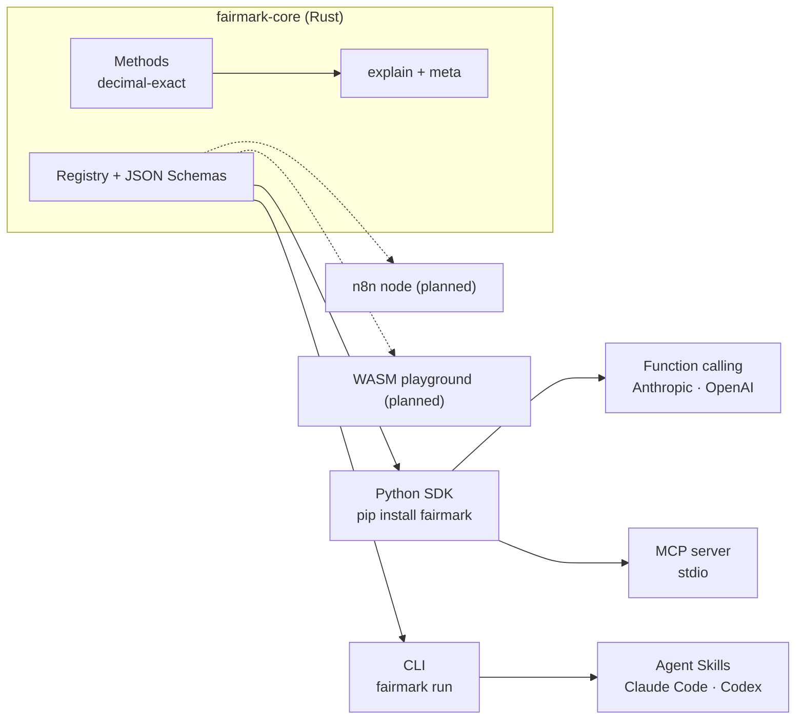

<div align="center">

# Fairmark

**Fair value, hallmarked.**

The deterministic valuation engine for analysts and AI agents.<br/>
Your agent reasons and writes the report. Fairmark does the math — exactly, with an audit trail.<br/><br/>
**[Documentation](https://fairmark-dev.github.io/fairmark/)** · [Quickstart](https://fairmark-dev.github.io/fairmark/getting-started/quickstart/) · [Methods](https://fairmark-dev.github.io/fairmark/methods/) · [Roadmap](https://fairmark-dev.github.io/fairmark/project/roadmap/)

[](https://github.com/fairmark-dev/fairmark/actions/workflows/ci.yml)
[](https://pypi.org/project/fairmark/)
[](https://crates.io/crates/fairmark-core)
[](LICENSE)
[](https://fairmark-dev.github.io/fairmark/)
[](#mcp-server)

</div>

---

## Why Fairmark

Large language models are great at reading a balance sheet and writing an investment memo.
They are not reliable calculators: a discount factor rounded the wrong way, a terminal value
discounted one year too many, a growth rate read as 20 instead of 0.02. In a valuation, those
mistakes change the answer.

Fairmark splits the job:

```
  document / prompt ──▶  LLM extracts the inputs  ──▶  Fairmark computes  ──▶  LLM writes the report
                                                       exact · auditable          citing every step
```

- **Deterministic.** Exact decimal arithmetic, no binary floats, fixed solvers. Same input, same
  output, to the last digit, on every platform. See [the determinism contract](docs/concepts/determinism.md).
- **Auditable.** Every result carries `explain`: the formula, the conventions and every
  intermediate step, ready to paste into a valuation report.
- **Agent-native.** One engine, every channel: Python, function calling (Anthropic, OpenAI),
  MCP, CLI, and Agent Skills for Claude Code and Codex.
- **Built for private companies and real assets.** Inputs come from financial statements and
  business plans, not stock tickers. European valuation practice is a first-class citizen.
- **Private by design.** The engine never touches the network. Your numbers stay on your machine.

## Install

```bash
pip install fairmark            # library + function-calling tools
pip install "fairmark[mcp]"     # + MCP server
```

Prebuilt wheels for Linux, macOS and Windows (x86_64 and arm64). No compiler needed.

## Quickstart

```python
import fairmark as fm

r = fm.dcf.fcff(
    free_cash_flows=[100, 110, 120],
    discount_rate="0.10",          # WACC, as a decimal fraction
    terminal_growth="0.02",
    net_debt=200,
)

r.enterprise_value      # Decimal('1421.4876033057851239669421487')
r.equity_value          # Decimal('1221.4876033057851239669421487')
r.terminal_value_weight # Decimal('0.8086680761099365750528541226')
print(r.explain_markdown())
```

```text
### dcf.fcff
| Step                           | Calculation                       | Value      |
| ------------------------------ | --------------------------------- | ---------: |
| Discount factor, year 1        | 1 / (1 + 0.10)^1                  | 0.90909... |
| Present value of FCFF, year 1  | 100 × 0.90909...                  | 90.9090... |
| ...                            |                                   |            |
| Terminal value at year n       | 120 × (1 + 0.02) / (0.10 − 0.02)  | 1530       |
| Enterprise value               | 271.9759... + 1149.5116...        | 1421.48... |
```

Pass numbers as `Decimal` or strings for exactness. Floats are accepted and converted through
their shortest representation (`0.1` → `"0.1"`).

## Use it from an AI agent

### Function calling (any LLM)

```python
import anthropic, fairmark as fm

client = anthropic.Anthropic()
messages = [{"role": "user", "content": "Value this company: FCFF 100, 110, 120; WACC 10%; g 2%; net debt 200."}]

response = client.messages.create(model="claude-opus-5-5", max_tokens=2048,
                                  tools=fm.tools.anthropic(), messages=messages)

for block in response.content:
    if block.type == "tool_use":
        result = fm.tools.dispatch(block.name, block.input)   # deterministic computation
        # send `result` back as a tool_result; the model writes the report citing explain.steps
```

`fm.tools.openai()` returns the same tools for OpenAI-compatible APIs. Tool definitions are
generated from the engine's JSON Schemas, so they never drift from the implementation.
Invalid inputs come back as `{"error": {"code": "FM-E004", ...}}` so the model can fix its call.

### MCP server

```json
{
  "mcpServers": {
    "fairmark": { "command": "uvx", "args": ["--from", "fairmark[mcp]", "fairmark-mcp"] }
  }
}
```

Runs locally over stdio. Nothing to host.

### Claude Code, Codex and other coding agents

Copy [`skills/fairmark`](skills/fairmark) into your agent's skills folder, or let the agent use
the CLI directly:

```bash
fairmark methods                                  # what can I compute?
fairmark schema dcf.fcff                          # what inputs does it need?
fairmark run dcf.fcff --input company.json        # JSON in, JSON out
fairmark verify result.json --input company.json  # reproduce a result bit for bit
```

## Methods

| Method | Status | Description |
| --- | --- | --- |
| `tvm.npv` | ✅ available | Net present value |
| `tvm.irr` | ✅ available | Internal rate of return (deterministic Newton + bisection) |
| `dcf.fcff` | ✅ preview | Unlevered DCF with Gordon terminal value, end or mid period |
| `dcf.fcfe`, WACC/CAPM, beta relevering | 🛠 M2 | Full DCF stack |
| Financial statements & reclassification | 🛠 M2 | Statutory accounts → FCFF, net financial position |
| Asset-based, income-based, mixed (excess earnings) methods | 🗓 M4 | European / Italian practice |
| EVA, market multiples | 🗓 M4 | |
| Real estate: property DCF, direct capitalisation, debt & waterfall | 🗓 roadmap | |

See the [roadmap](roadmap/roadmap.yaml) and the [open issues](https://github.com/fairmark-dev/fairmark/issues).

## Architecture



One Rust engine, thin adapters. Every adapter is generated from the same registry and schemas,
so a method added to the core is immediately available to Python, the CLI, MCP and every LLM.
Details in [docs/concepts/architecture.md](docs/concepts/architecture.md).

## The determinism contract

1. Decimal arithmetic only (96-bit mantissa); no `f64` in any calculation path.
2. Fixed algorithms with tolerances and iteration counts reported in the result.
3. No silent defaults: missing or unknown inputs are typed errors with stable codes.
4. Every result carries `meta.input_hash`: same hash + same versions = same result.
5. Any change to a golden result is a versioned, documented `numerical change`.

Golden cases live in [`tests/golden`](tests/golden) and run against both Rust and Python on
every commit.

## Privacy

The engine has no network dependencies, enforced in CI. Optional, opt-in usage statistics are
under public discussion in [docs/project/telemetry.md](docs/project/telemetry.md) and will never include
financial data.

## Contributing

Fairmark is built in the open and designed for parallel contributions: every method is an
independent module with its own golden cases. Start with [CONTRIBUTING.md](CONTRIBUTING.md) and
the issues labelled [`good first issue`](https://github.com/fairmark-dev/fairmark/labels/good%20first%20issue).

Valuation professionals are as welcome as developers: a well-documented test case is a
first-class contribution.

## License

[Apache-2.0](LICENSE). The license covers the code; it grants no rights to use the Fairmark
name or logo (Apache-2.0, section 6).

> Fairmark computes what you ask it to compute. It is not investment, accounting or legal advice;
> the choice of method and inputs remains the analyst's responsibility.
