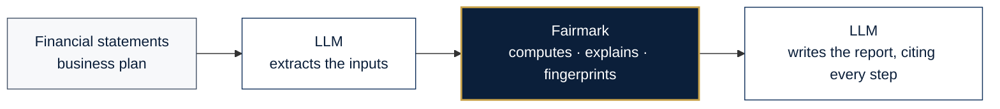
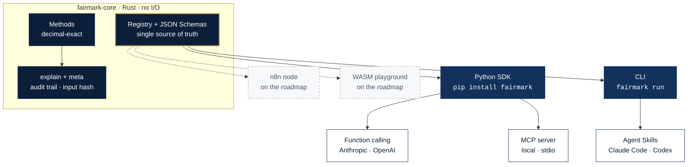

<div align="center">

<a href="https://salvo8519.github.io/fairmark/">
  <picture>
    <source media="(prefers-color-scheme: dark)" srcset="docs/_shared/assets/brand/banner-dark.svg">
    
  </picture>
</a>

**English** · [Italiano](README.it.md)

<h3>The deterministic valuation engine for analysts and AI agents.</h3>

Your agent reads the documents and writes the report. Fairmark does the math —<br/>
exactly, reproducibly, with every step on the record.

[](https://github.com/salvo8519/fairmark/actions/workflows/ci.yml)
[](https://salvo8519.github.io/fairmark/)
[](https://pypi.org/project/fairmark/)
[](https://pypi.org/project/fairmark/)
[](https://crates.io/crates/fairmark-core)
[](LICENSE)

[](https://salvo8519.github.io/fairmark/guides/mcp/)
[](https://salvo8519.github.io/fairmark/guides/function-calling/)
[](crates/fairmark-core)
[](https://docs.astral.sh/uv/)
[](specs/README.md)

**[Documentation](https://salvo8519.github.io/fairmark/)** ·
**[Quickstart](https://salvo8519.github.io/fairmark/getting-started/quickstart/)** ·
**[Methods](https://salvo8519.github.io/fairmark/methods/)** ·
**[Roadmap](https://salvo8519.github.io/fairmark/project/roadmap/)** ·
**[Contributing](CONTRIBUTING.md)**

</div>

---

## Why Fairmark

Language models are excellent at reading financial statements and drafting an investment memo.
They are not reliable calculators: a discount factor rounded the wrong way, a terminal value
discounted one year too many, a growth rate read as 20 instead of 0.02. In a valuation, those
mistakes change the answer — and nobody can tell.

Fairmark splits the job in two:



| | |
| --- | --- |
| **Deterministic** | Exact decimal arithmetic, fixed solvers. Same input, same output, to the last digit, on every platform. |
| **Auditable** | Every result carries `explain`: formula, conventions and each intermediate step — ready for a valuation report. |
| **Reproducible** | Every result carries an input fingerprint; `fairmark verify` re-runs it bit for bit. |
| **Agent-native** | One engine for Python, function calling, MCP, the CLI and Agent Skills for Claude Code and Codex. |
| **Built for private companies** | Inputs come from financial statements and business plans, not tickers. European practice is first-class. |
| **Private by design** | The engine never touches the network. Your numbers stay on your machine. |

## Install

```bash
uv add fairmark              # or: pip install fairmark
uv add "fairmark[mcp]"       # + MCP server
```

Prebuilt wheels for Linux, macOS and Windows (x86_64 and arm64) — no compiler needed.

## Quickstart

```python
import fairmark as fm

r = fm.dcf.fcff(
    [fm.dcf.given([100, 110, 120])],   # one stage: FCFF of years 1 to 3
    cash_flow_terms="nominal",
    discount_rate_terms="nominal",
    wacc="0.10",                       # as a decimal fraction
    timing="end_of_period",
    terminal=fm.dcf.gordon("0.02", first_flow="last_flow_grown"),
    net_financial_position={"gross_debt": 200, "cash": 0},
)

r.value_of_operations    # Decimal('1421.4876033057851239669421487')
r.equity_value           # Decimal('1221.4876033057851239669421487')
r.terminal_value_weight  # Decimal('0.8086680761099365750528541226')
print(r.explain_markdown())
```

```text
| Step                                | Calculation                  | Value        |
| ----------------------------------- | ---------------------------- | -----------: |
| Period 1: discount factor           | 1 / (1 + 0.10)               | 0.909090...  |
| Period 1: present value             | 100 × 0.909090...            | 90.909090... |
| Terminal value: Terminal value at N | 122.40 / (0.10 − 0.02)       | 1530         |
| Value of operations                 | 271.9759... + 1149.5116...   | 1421.4876... |
| Equity value                        | 1421.4876... − 200           | 1221.4876... |
```

> **Tip.** Pass amounts and rates as strings or `Decimal` for exactness. Floats are accepted and
> converted through their shortest representation (`0.1` → `"0.1"`).

## Use it from an AI agent

<table>
<tr><th>Function calling</th><th>MCP server</th></tr>
<tr><td>

```python
resp = client.messages.create(
    model="claude-opus-5-5",
    tools=fm.tools.anthropic(),   # or fm.tools.openai()
    messages=messages,
)
for block in resp.content:
    if block.type == "tool_use":
        out = fm.tools.dispatch(block.name, block.input)
```

</td><td>

```json
{
  "mcpServers": {
    "fairmark": {
      "command": "uvx",
      "args": ["--from", "fairmark[mcp]", "fairmark-mcp"]
    }
  }
}
```

</td></tr>
</table>

**Any provider** — Anthropic, OpenAI, Google Gemini, OpenRouter, LiteLLM, and open-weight
models on Ollama, vLLM or LM Studio: `fm.tools.for_provider("ollama")` returns the right tool
format, `fm.tools.dispatch` executes the call. LangChain tools and MCP over HTTP (for n8n) are
included. See [LLM providers](https://salvo8519.github.io/fairmark/guides/providers/).

**Claude Code, Codex and other coding agents** — copy [`skills/fairmark`](skills/fairmark)
into your agent's skills folder, or let it drive the CLI:

```bash
fairmark methods                                  # what can I compute?
fairmark schema dcf.fcff                          # which inputs, with units?
fairmark run dcf.fcff --input company.json        # JSON in, JSON out
fairmark verify result.json --input company.json  # reproduce a result bit for bit
```

> **Note.** Tool definitions are generated from the engine's JSON Schemas, so they never drift from the
> implementation. Invalid inputs come back as `{"error": {"code": "FM-E004", …}}` so the model
> can correct its own call.

## Methods

<!-- generated:methods:start (scripts/gen_reference.py) -->

| Method | Status | Description |
| --- | --- | --- |
| `dates.year_fraction` | Preview | Year fraction (day count) |
| `rates.convert` | Preview | Rate conversion between compounding conventions |
| `rates.real_nominal` | Preview | Real and nominal rates (Fisher) |
| `tvm.npv` | Preview | Net present value |
| `tvm.present_value` | Preview | Present value with a constant or time-varying rate |
| `tvm.xnpv` | Preview | Net present value of dated cash flows (XNPV) |
| `tvm.irr` | Preview | Internal rate of return |
| `tvm.xirr` | Preview | Internal rate of return of dated cash flows (XIRR) |
| `tvm.mirr` | Preview | Modified internal rate of return (MIRR) |
| `tvm.annuity` | Preview | Annuity (level or growing, ordinary or due) |
| `tvm.perpetuity` | Preview | Perpetuity (level or growing) |
| `tvm.future_value` | Available | Future value of a present amount and level payments |
| `loans.instalment` | Available | Loan instalment (constant instalment, optional balloon) |
| `loans.number_of_instalments` | Available | Number of instalments of a loan |
| `loans.amortisation_schedule` | Available | Amortisation schedule (French, constant principal, bullet) |
| `coc.cost_of_equity` | Available | Cost of equity (CAPM with explicit premia) |
| `coc.beta_relever` | Available | Beta unlevering and relevering |
| `coc.beta_peers` | Available | Beta from comparable companies |
| `coc.cost_of_debt` | Available | Cost of debt |
| `coc.wacc` | Available | Weighted average cost of capital (WACC) |
| `tv.gordon` | Available | Terminal value, stable growth (Gordon) |
| `tv.value_driver` | Available | Terminal value, value driver (growth from reinvestment) |
| `tv.h_model` | Available | Terminal value, H-model (declining growth) |
| `tv.exit_multiple` | Available | Terminal value, exit multiple |
| `tv.limited_horizon` | Available | Terminal value, finite horizon |
| `tv.normalised_income` | Available | Terminal value, capitalised normalised income |
| `tv.liquidation` | Available | Terminal value, liquidation |
| `tv.compare` | Available | Terminal value, comparison of techniques |
| `dcf.fcff` | Preview | DCF — unlevered free cash flow |
| `ratios.profitability` | Preview | Ratios — profitability |
| `ratios.capital_structure` | Preview | Ratios — capital structure |
| `ratios.liquidity` | Preview | Ratios — liquidity |
| `ratios.working_capital` | Preview | Ratios — working capital |
| `ratios.debt_service` | Preview | Ratios — debt service |
| `ratios.covenants` | Preview | Ratios — covenants |
| `analysis.goal_seek` | Available | Goal seek |
| `analysis.sensitivity` | Available | Sensitivity table |
| `analysis.scenarios` | Available | Scenario analysis |
| `analysis.tornado` | Available | Tornado |

What comes next, with its issues and specifications, is in the [roadmap](https://salvo8519.github.io/fairmark/project/roadmap/), generated from the plan.

<!-- generated:methods:end -->

## Architecture



> **One engine, thin adapters.** Every channel is generated from the same registry and
> schemas: a method added to the core is immediately available to Python, the CLI, MCP and
> every LLM. Details in [docs/en/concepts/architecture.md](docs/en/concepts/architecture.md).

## The determinism contract

1. Decimal arithmetic only — no `f64` in any calculation path.
2. Fixed algorithms; tolerances and iteration counts are reported in the result.
3. No silent defaults: unknown or missing inputs are typed errors with stable codes.
4. Every result carries `meta.input_hash`: same hash + same versions = same result.
5. Any change to a golden result is a reviewed, versioned `numerical-change`.

Golden cases in [`tests/golden`](tests/golden) run against both Rust and Python on every
commit. Read the full [contract](docs/en/concepts/determinism.md) and the project's
[constitution](specs/constitution.md).

## Built in the open, spec-first

Fairmark is developed with **spec-driven development** and is ready for **agentic
contributors**: every feature starts as a spec with numbered requirements and acceptance
criteria ([`specs/`](specs/README.md)); every acceptance criterion becomes a test; every PR is
checked by CI for determinism, schema contracts and golden cases, and reviewed by humans and
by AI reviewers with the project's own standards ([`AGENTS.md`](AGENTS.md)).

- Start with [CONTRIBUTING.md](CONTRIBUTING.md) and issues labelled
  [`good first issue`](https://github.com/salvo8519/fairmark/labels/good%20first%20issue).
- Valuation professionals are as welcome as developers: a well-sourced test case is a
  first-class contribution.

## License

[Apache-2.0](LICENSE). The license covers the code; it grants no rights to use the Fairmark
name or logo (Apache-2.0, section 6).

## Disclaimer

Fairmark is a calculation tool, not an advisor: it computes, the user decides. Every decision
taken with the help of Fairmark, and every use of its results, belongs exclusively to the user,
who chooses the method and the inputs, directly or through an AI agent, and verifies the
results before relying on them. Fairmark provides no investment, financial, accounting, tax or
legal advice, and is provided without warranty of any kind under the Apache License 2.0.
Read the full [disclaimer](DISCLAIMER.md).
