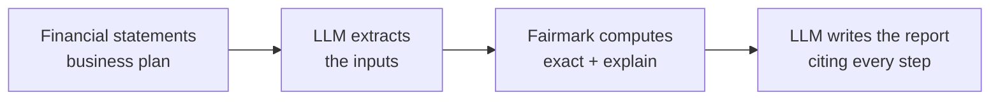

---
hide:
  - navigation
  - toc
---

<div class="fm-hero" markdown>

{ width="96" }

# Fairmark

<p class="fm-tagline">Fair value, hallmarked.</p>

The deterministic valuation engine for analysts and AI agents.
Your agent reasons and writes the report. Fairmark does the math — exactly, with an audit trail.

[Get started](getting-started/quickstart.md){ .md-button .md-button--primary }
[Use it with an agent](getting-started/first-valuation-with-an-agent.md){ .md-button }

</div>

```bash
pip install fairmark
```

```python
import fairmark as fm

r = fm.dcf.fcff([100, 110, 120], discount_rate="0.10", terminal_growth="0.02", net_debt=200)
r.equity_value        # Decimal('1221.4876033057851239669421487') — exact, reproducible
r.explain_markdown()  # every step, ready for your valuation report
```

<div class="grid cards fm-features" markdown>

-   :material-scale-balance:{ .lg .middle } __Deterministic__

    ---

    Exact decimal arithmetic and fixed solvers. Same input, same output, to the last digit,
    on every platform.

    [:octicons-arrow-right-24: The determinism contract](concepts/determinism.md)

-   :material-file-document-check-outline:{ .lg .middle } __Auditable__

    ---

    Every result explains itself: formula, conventions and each intermediate step,
    plus a fingerprint to reproduce it later.

    [:octicons-arrow-right-24: The audit trail](concepts/audit-trail.md)

-   :material-robot-outline:{ .lg .middle } __Agent-native__

    ---

    One engine for Python, function calling, MCP, the CLI and Agent Skills for Claude Code
    and Codex. The model never does the arithmetic.

    [:octicons-arrow-right-24: Agent guides](guides/function-calling.md)

-   :material-office-building-outline:{ .lg .middle } __Built for private companies__

    ---

    Inputs come from financial statements and business plans, not tickers. European
    valuation practice is first-class.

    [:octicons-arrow-right-24: Methods](methods/index.md)

</div>

## How it fits in your workflow



!!! note "Status: pre-alpha"
    Fairmark is under active development. NPV, IRR and DCF (FCFF) are available today;
    see the [roadmap](project/roadmap.md) for what comes next.
