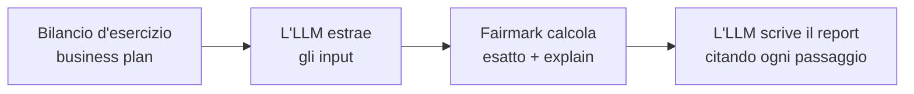

---
hide:
- navigation
- toc
source: index.md
source_hash: 3379c0108446
---
<div class="fm-hero" markdown>

{ width="96" }

# Fairmark

<p class="fm-tagline">Fair value, hallmarked.</p>

Il motore di valutazione deterministico per analisti e agenti AI.
Il tuo agente ragiona e scrive il report. Fairmark fa i conti: in modo esatto, con la
tracciabilità completa del calcolo.

[Inizia](getting-started/quickstart.md){ .md-button .md-button--primary }
[Usalo con un agente](getting-started/first-valuation-with-an-agent.md){ .md-button }

</div>

```bash
pip install fairmark
```

```python
import fairmark as fm

r = fm.dcf.fcff(
    [fm.dcf.given([100, 110, 120])],                    # FCFF degli anni da 1 a 3
    cash_flow_terms="nominal", discount_rate_terms="nominal",
    wacc="0.10", timing="end_of_period",
    terminal=fm.dcf.gordon("0.02", first_flow="last_flow_grown"),
    net_financial_position={"gross_debt": 200, "cash": 0},
)
r.equity_value        # Decimal('1221.4876033057851239669421487') — esatto, riproducibile
r.explain_markdown()  # ogni passaggio, pronto per la relazione di valutazione
```

<div class="grid cards fm-features" markdown>

-   __Deterministico__

    ---

    Aritmetica decimale esatta e algoritmi fissi. Stesso input, stesso output, fino all'ultima
    cifra, su ogni piattaforma.

    [Il contratto di determinismo](concepts/determinism.md)

-   __Verificabile__

    ---

    Ogni risultato spiega se stesso: formula, convenzioni e ogni passaggio intermedio, più
    un'impronta per riprodurlo in seguito.

    [La tracciabilità del calcolo](concepts/audit-trail.md)

-   __Nativo per gli agenti__

    ---

    Un solo motore per Python, function calling, MCP, CLI e Agent Skills per Claude Code e
    Codex. Il modello non esegue mai i calcoli.

    [Guide per gli agenti](guides/function-calling.md)

-   __Pensato per le società non quotate__

    ---

    Gli input arrivano dal bilancio d'esercizio e dal business plan, non da un ticker. La
    prassi valutativa europea è supportata in modo nativo.

    [Metodi](methods/index.md)

</div>

## Dove si colloca nel tuo flusso di lavoro



!!! note "Stato: pre-alpha"
    Fairmark è in sviluppo attivo. Oggi sono disponibili VAN, TIR e DCF (FCFF); la
    [roadmap](https://salvo8519.github.io/fairmark/project/roadmap/) (in inglese) descrive i prossimi passi.

!!! warning "Uno strumento di calcolo, non una consulenza"
    Fairmark calcola; l'utilizzatore decide. Ogni decisione presa con i suoi risultati, e ogni
    loro uso, appartiene all'utilizzatore, che li verifica prima di farvi affidamento. Fairmark
    non fornisce consulenza in materia di investimenti, finanziaria, contabile, fiscale o
    legale. Leggi le [avvertenze legali](disclaimer.md).
